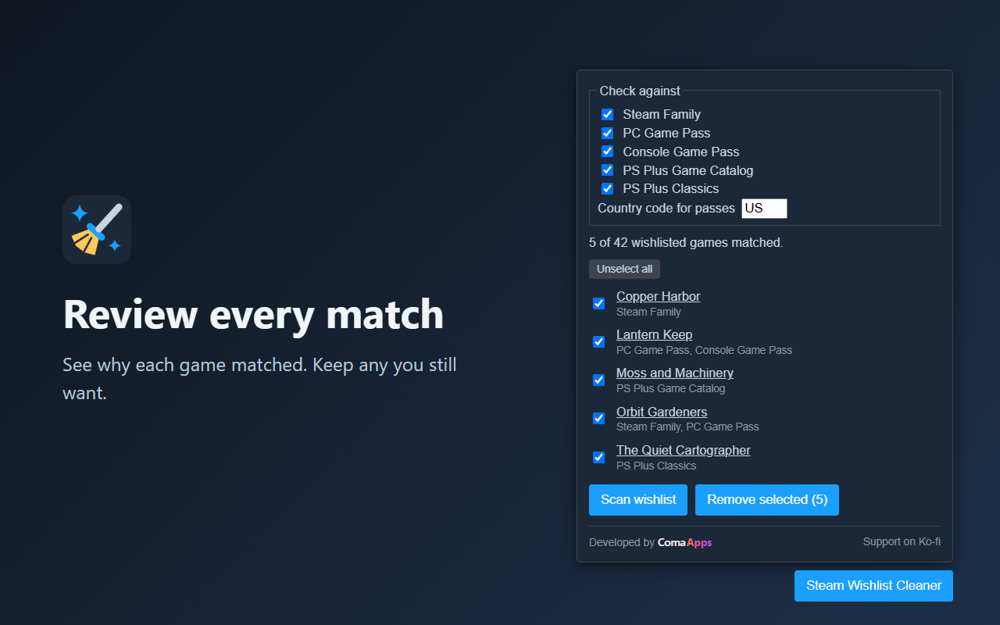

<p align="center">
  
</p>

<h1 align="center">Steam Wishlist Cleaner</h1>

<p align="center">
  Remove games from your Steam wishlist that you can already play.<br>
  Developed by <a href="https://comaapps.dev/">ComaApps</a> ·
  <a href="https://ko-fi.com/comaapps">Support on Ko-fi</a>
</p>

<p align="center">
  <b><a href="https://microsoftedge.microsoft.com/addons/detail/steam-wishlist-cleaner/feljepenkddfhfmopgkfpdfbcbbkhlen">Get it for Microsoft Edge</a></b> ·
  <b><a href="https://chromewebstore.google.com/detail/steam-wishlist-cleaner/fppnhlbhhceonmlikhbenkeecnkaogpl">Get it for Google Chrome</a></b>
</p>



<p align="center"><sub>The real panel with made-up sample games.</sub></p>

## What it does

It checks your wishlist against:

- games shared by your **Steam Family**
- **PC Game Pass** and **Console Game Pass**
- the **PS Plus** Game Catalog and Classics

Scanning changes nothing. You see why each game matched, untick what you want to keep,
confirm, and can undo your latest removal.

> Not affiliated with or endorsed by Valve, Microsoft or Sony. It relies on undocumented
> services that can change at any time. Use it at your own risk.

## Download and install

Install the browser extension from your browser's store. Get the plugins from the
[latest release](https://github.com/cosmintoncean/SteamWishlistCleaner/releases/latest).

| Version | Works in | Status | Get it from |
|---|---|---|---|
| [Browser extension](#browser-extension) | Microsoft Edge and Google Chrome | Tested in both | [Edge Add-ons](https://microsoftedge.microsoft.com/addons/detail/steam-wishlist-cleaner/feljepenkddfhfmopgkfpdfbcbbkhlen), [Chrome Web Store](https://chromewebstore.google.com/detail/steam-wishlist-cleaner/fppnhlbhhceonmlikhbenkeecnkaogpl) |
| [Millennium plugin](#millennium-plugin) | Steam desktop client | Tested when built from source | `steam-wishlist-cleaner-millennium-<version>.star` |
| [Decky Loader plugin](#decky-loader-plugin) | Steam Deck, Gaming Mode | **Experimental: never run on a Deck** | `steam-wishlist-cleaner-decky-<version>.zip` |

The plugins are not in the Millennium or Decky stores and have not been reviewed by either
project. Install them only if you're comfortable running software from outside those stores.

### Browser extension

| Browser | Install |
|---|---|
| Microsoft Edge | Open [Microsoft Edge Add-ons](https://microsoftedge.microsoft.com/addons/detail/steam-wishlist-cleaner/feljepenkddfhfmopgkfpdfbcbbkhlen) and click **Get** |
| Google Chrome | Open the [Chrome Web Store](https://chromewebstore.google.com/detail/steam-wishlist-cleaner/fppnhlbhhceonmlikhbenkeecnkaogpl) and click **Add to Chrome** |

Then open your Steam wishlist; refresh the page if it was already open. The store keeps the
extension up to date.

If you installed it manually before, remove that copy first so you don't run two.

#### Inside the Steam client (Extendium)

[Extendium](https://github.com/BossSloth/Extendium), a third-party Millennium plugin, runs
browser extensions inside the Steam desktop client. This extension has not been tested with
it.

1. Install [Millennium](https://steambrew.app), then add Extendium from Millennium's plugin
   settings (its ID is listed on [steambrew.app/plugins](https://steambrew.app/plugins)).
   Restart Steam.
2. In Extendium's **Extensions Manager**, choose **Install extension**. The Chrome Web Store
   opens.
3. Go to the [Steam Wishlist Cleaner page](https://chromewebstore.google.com/detail/steam-wishlist-cleaner/fppnhlbhhceonmlikhbenkeecnkaogpl) and install it.
4. Open your wishlist in the Store tab and click **Wishlist Cleaner**.

If you have the [Millennium plugin](#millennium-plugin) from this project enabled, disable it
first so only one copy runs. Extendium lets an extension run inside your signed-in Steam
client, so check its notes before installing.

#### Manual install

For other Chromium browsers, such as Brave (untested), or to run a release file:

1. Download `steam-wishlist-cleaner-browser-<version>.zip` from the latest release.
2. Extract it into a folder you'll keep. The browser loads the extension from there, so
   don't delete or move it.
3. Open `edge://extensions` (or `chrome://extensions`).
4. Turn on **Developer mode**.
5. Click **Load unpacked** and choose the extracted folder (the one containing
   `manifest.json`).

**Update:** replace the folder's contents with the new version, then click the reload icon on
the extension's card.

### Millennium plugin

This is the native alternative to [running the browser extension through
Extendium](#inside-the-steam-client-extendium).

1. Install [Millennium](https://steambrew.app) 3.4 or newer.
2. Download `steam-wishlist-cleaner-millennium-<version>.star` from the latest release.
3. Quit Steam completely.
4. Copy the file into Millennium's plugin folder. On Windows this is normally
   `C:\Program Files (x86)\Steam\millennium\plugins`.
5. Start Steam, open Millennium's settings, and enable **Steam Wishlist Cleaner** under
   plugins.

Installing the downloaded file by hand has not been tested, and the package is unsigned. The
plugin has been tested when installed by [building from source](#build-from-source), so use
that if the file doesn't appear in Millennium.

**Update or remove:** quit Steam, then replace or delete the file.

### Decky Loader plugin

1. Install [Decky Loader](https://decky.xyz) on your Steam Deck.
2. In Desktop Mode, download `steam-wishlist-cleaner-decky-<version>.zip` from the latest
   release. Don't extract it.
3. Back in Gaming Mode, open the Quick Access menu (**…** button), choose the Decky tab and
   open its settings (gear icon).
4. Turn on **Developer mode**, then in the **Developer** section choose to install a plugin
   from a ZIP file and select the download. You can instead use **install from URL** with
   the file's download link. Menu names can differ between Decky versions.

## Use

1. Sign in to the Steam store and open your wishlist, then click **Wishlist Cleaner** at the
   bottom right. On a Steam Deck, open the Store once, then open the plugin from the Quick
   Access menu.
2. Under **Check against**, pick Steam Family and the subscriptions you have, and enter your
   two-letter country code.
3. Click **Scan wishlist**.
4. Untick (Deck: switch off) any game you want to keep. **Unselect all** and **Select all**
   change the whole list at once.
5. Click **Remove selected**, then click again to confirm.

**Undo last removal** adds the games from your latest removal back and lists them again,
unticked. Steam treats them as newly added, so their original date and position are lost.
Each version remembers its own removals. Refresh the wishlist page to see changes.

The tool always works on the signed-in account's wishlist.

## What counts as a match

**Steam Family:** another member owns it, Steam does not mark it as excluded from sharing,
and you don't own it yourself.

**Game Pass and PS Plus:** the Steam name matches a title in that subscription's current
catalog. Trademark signs, accents, punctuation and platform labels are ignored. Editions
must match, so "Game Remastered" doesn't match "Game", and some games will be missed. Two
different games can share a name (an original and its remake), so check the list.

| Choice | Catalog |
|---|---|
| PC Game Pass | All PC games |
| Console Game Pass | All console games |
| PS Plus Game Catalog | PS Plus Extra and Premium games (PS4, PS5) |
| PS Plus Classics | Premium classics |

Catalogs differ by country and change often: a game may leave a catalog later. Monthly PS
Plus games are not checked. If you want your own copy of a game, keep it.

## Privacy

Your Steam web access token is read from a store page and used only for requests to
`api.steampowered.com`. It is not saved or logged. Only your **Check against** choices and
the games from your latest removal are stored, on your device. Subscription catalogs are
read from Microsoft and PlayStation sites without your Steam details. There are no
analytics or ads. Full policy: [PRIVACY.md](PRIVACY.md).

- **Millennium:** the plugin's backend makes the requests, limited to the read-only
  addresses it needs.
- **Decky:** the backend runs the token and wishlist requests inside an open store page,
  through Steam's local debugger.

## Build from source

Needs Node.js 24 or newer and Python 3. In Windows PowerShell, use `npm.cmd` if `npm` is
blocked.

```powershell
npm install
```

```powershell
npm install --prefix millennium
```

| To get | Run | Result |
|---|---|---|
| Browser extension | `npm run build:browser` | Load `dist/browser` as an unpacked extension |
| Millennium plugin | `npm run build:millennium` | Compiled and installed into Millennium |
| Decky plugin | `npm run build:decky` | Compiled into `decky/dist` |

### Development

```powershell
npm test
```

Type checks need Millennium's type files, generated once:

```powershell
cd millennium; npx starlight lsp; cd ..
```

```powershell
npm run typecheck
```

To check that the public catalogs still respond:

```powershell
node scripts/check-catalogs.mjs US
```

| Folder | Contents |
|---|---|
| `shared/` | Matching rules, catalogs, bulk changes, and the panel used on store pages |
| `browser/` | Browser extension |
| `millennium/` | Millennium plugin: Lua backend and store page script |
| `decky/` | Decky plugin: Python backend and Quick Access panel |

### Releasing

1. Set the new version in `package.json`, `browser/manifest.source.json`,
   `decky/package.json` and `millennium/millennium.toml`, and update `CHANGELOG.md`.
2. Add `docs/release-notes-<version>.md`.
3. Run `npm run release`. The files and checksums appear in `dist/release`.
4. Tag the commit and create a GitHub release with the two zips, the `.star` file and
   `SHA256SUMS.txt`.
5. Upload the browser zip as an update in Partner Center and the Chrome developer dashboard.
6. If `PRIVACY.md` changed, publish the new `dist/release/privacy.html` on the website.

Store form text is in [docs/store-listing.md](docs/store-listing.md).

## About

This project was written with AI assistance.

Questions and problems: open an
[issue](https://github.com/cosmintoncean/SteamWishlistCleaner/issues).

Licensed under [BSD-3-Clause](LICENSE). See also [third-party notices](THIRD_PARTY_NOTICES.md)
and the [changelog](CHANGELOG.md).
